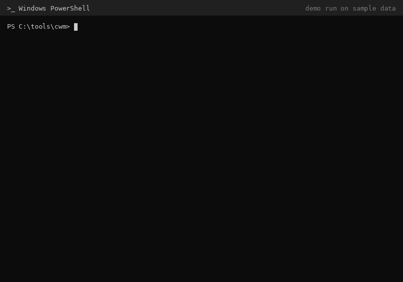

# Cursor workspace migration

**Move or rename a Cursor project folder without losing your Agent chat history, thread titles, or agent transcripts.**

[](LICENSE)


<p align="center">
  
  <br/>
  <sub>Demo run on sample data: dry run → migration → verification.</sub>
</p>

## Why

Cursor ties chats to the folder's absolute path. Move `C:\temp\demo-app` to `D:\projects\storefront` (or just rename it), open it, and the chat sidebar is empty. Your threads are still on disk, bound to the old path.

Project data lives in four places, and copying the folder only covers the first one:

| Layer | Location | If you skip it |
|-------|----------|----------------|
| 1. Project files | your folder | n/a, you copy it |
| 2. Agent transcripts | `%USERPROFILE%\.cursor\projects\<slug>\` | missing transcript files |
| 3. Chat sidebar | `%APPDATA%\Cursor\User\workspaceStorage\<hash>\` | empty sidebar |
| 4. Thread titles and binding | `%APPDATA%\Cursor\User\globalStorage\state.vscdb` → `composer.composerHeaders` | "New Agent" tabs, wrong titles |

These scripts move layers 2–4 to the new path and then check the result.

## Quick start

Requires Windows, PowerShell 5.1+, and Python 3.9+ on `PATH` as `python` (standard library only, nothing to `pip install`).

```powershell
git clone https://github.com/kamilkaczmareksolutions/cursor-workspace-migration
cd cursor-workspace-migration
Set-ExecutionPolicy -Scope Process Bypass

$src = "C:\old\path\MyProject"
$dst = "C:\new\path\MyProject"

# 1. Copy the project files (robocopy exit codes 0-7 mean success)
robocopy $src $dst /E /COPY:DAT /DCOPY:DAT /R:2 /W:2
.\scripts\parity-check.ps1 -Source $src -Dest $dst -ExcludeVolatile

# 2. In Cursor: File -> Open Folder -> $dst, wait for it to load, then File -> Exit.
#    This creates the new workspace hash the script needs.

# 3. Preview (read-only, safe while Cursor is open)
.\scripts\auto-migrate.ps1 -Source $src -Destination $dst -DryRun

# 4. Migrate. Cursor must be fully closed (the script refuses if Cursor.exe is running)
.\scripts\auto-migrate.ps1 -Source $src -Destination $dst

# 5. Open $dst in Cursor, then verify
.\scripts\verify-migration.ps1 -Source $src -Destination $dst
```

`verify-migration.ps1` ends with `CONFIDENCE: 100% - all hard checks PASS` when everything lines up.

Prefer letting an agent drive it? This repo ships a Cursor skill (`.cursor/skills/cursor-workspace-migration/`) and a subagent (`.cursor/agents/workspace-migrator.md`) that follow the three-phase [runbook](docs/RUNBOOK.md). There is also a [manual, config-file flow](docs/MIGRATION.md) if you want to set the hashes yourself.

## What gets migrated

`auto-migrate.ps1` finds the workspace hashes and project slugs for both paths on its own, then:

- **Agent transcripts**: copies `.cursor\projects\<old-slug>` to `<new-slug>`.
- **Chat sidebar**: copies the old `workspaceStorage\<hash>` folder to the new hash, rewrites `workspace.json`, and patches old paths inside its `state.vscdb`.
- **Thread titles**: rebinds every thread in `composer.composerHeaders` from the old workspace to the new one, and removes empty unnamed "ghost" tabs on the new workspace.

It's a move, not a copy: after the migration the threads appear under the new folder only, so you don't get duplicates.

`verify-migration.ps1` then runs hard checks: sha256 file parity, new workspace hash and DB present, `workspace.json` pointing to the destination, thread counts (new ≥ old, old = 0), transcript counts, and top-level folder contents.

## Limitations and backups

- **Windows only.** Paths are hardcoded to `%APPDATA%` and `%USERPROFILE%`. [MIGRATION.md](docs/MIGRATION.md#macos-notes) lists the macOS locations if you want to port it.
- **Cursor must be closed** for the real run. `state.vscdb` is locked while Cursor is running.
- **Open the destination once first.** If Cursor hasn't created a workspace hash for the new path yet, the script stops with `new workspace hash not found`.
- **It edits Cursor's internal SQLite databases.** The key layout isn't a public API. The scripts were tested on Cursor 3.x and need Cursor >= 2.1.42. A future Cursor update could change the format.
- **Doesn't copy your project files** (use `robocopy` as above) and doesn't re-index semantic search tools. See [INDEXING.md](docs/INDEXING.md).
- **Check the dry run** before the real run: the detected hashes and the `new project slug` should match your destination.

**Backups.** Before every write, the scripts make timestamped copies: `globalStorage\state.vscdb.bak-meta-<timestamp>`, `workspaceStorage\<new-hash>.bak-meta-<timestamp>` (when it already exists), and `.cursor\projects\<new-slug>.bak-<timestamp>` (when it already exists). Keep the source folder until you've checked the result. For extra safety, back up `%APPDATA%\Cursor\User\` yourself before the first run. Rollback steps are in [RUNBOOK.md](docs/RUNBOOK.md#rollback).

## FAQ

**Can't I just rename `.cursor\projects\<slug>`?**
That only brings back the transcripts. The sidebar list and thread titles live in two SQLite databases keyed by workspace hash, so you'd still get an empty sidebar or "New Agent" tabs.

**Will my chats still show up in the old folder?**
No. Threads are rebound to the new workspace, and the verify step checks that the old one has 0 named threads. The old files and backups stay on disk until you delete them.

**Verify says `ghosts=1`. Is that a problem?**
No. Opening the destination creates one fresh unnamed "New Chat" tab. It's reported as a soft check and doesn't fail verification. More cases are in [TROUBLESHOOTING.md](docs/TROUBLESHOOTING.md).

**Does it send anything anywhere?**
No. Everything runs locally with PowerShell and the Python standard library. There are no network calls and no API keys. Don't commit your `migration.config.json` (it's in `.gitignore`).

## Documentation

- [docs/RUNBOOK.md](docs/RUNBOOK.md): agent-assisted migration, with a case study
- [docs/MIGRATION.md](docs/MIGRATION.md): manual, config-file procedure
- [docs/TROUBLESHOOTING.md](docs/TROUBLESHOOTING.md): empty chats, wrong titles, slug issues, rollback
- [docs/INDEXING.md](docs/INDEXING.md): semantic search indexes after a path change

<details>
<summary>All scripts</summary>

| Script | Purpose |
|--------|---------|
| `auto-migrate.ps1` | Auto-detect hashes/slugs, copy slug, remap metadata (`-DryRun` supported) |
| `verify-migration.ps1` | End-to-end verification with a confidence score |
| `parity-check.ps1` | sha256 + size file parity (`-ExcludeVolatile` skips `.cursor/plans/`, `*.plan.md`) |
| `remap-cursor-meta.py` | Remap `composer.composerHeaders` and sync `workspaceStorage` (called by `auto-migrate.ps1`) |
| `count-threads.py` | Count threads / ghosts per workspace hash |
| `find-workspace-hash.ps1` | List `workspaceStorage` hash ↔ folder path |
| `migrate-workspace.ps1` | Manual flow: copy files and rename the projects slug |
| `migrate-chats.ps1` | Manual flow: copy the `workspaceStorage` state DB |
| `fix-chat-metadata.py` | Manual flow: remap headers using `migration.config.json` |

</details>

## License

MIT, see [LICENSE](LICENSE).

---

If this saved your chats, a ⭐ helps others find it.
